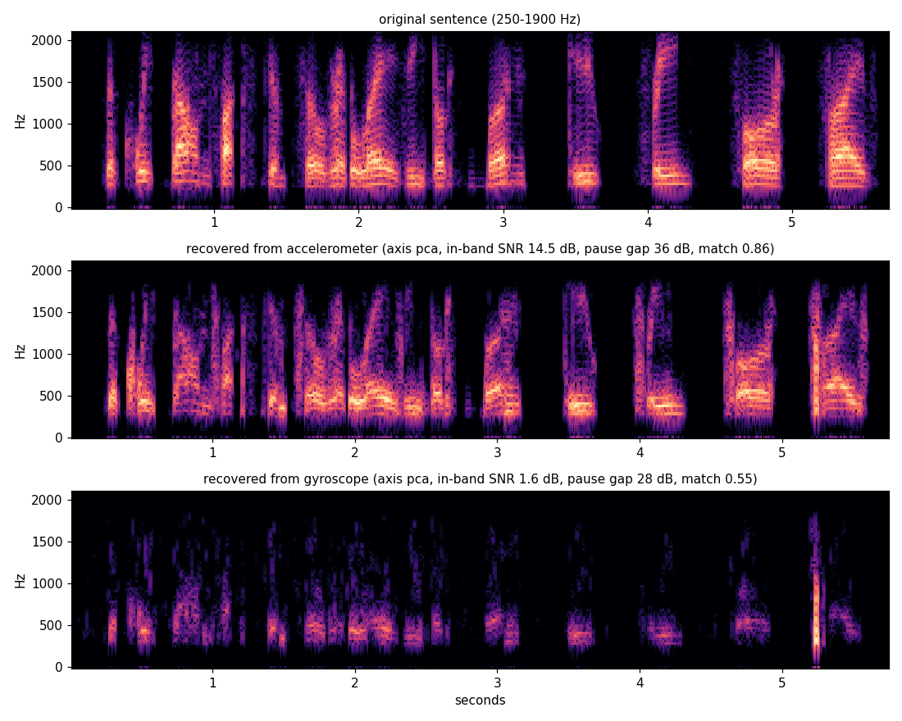
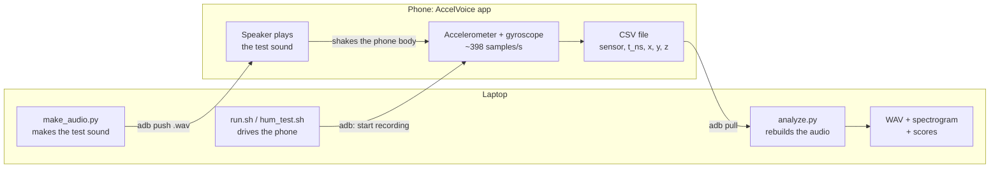
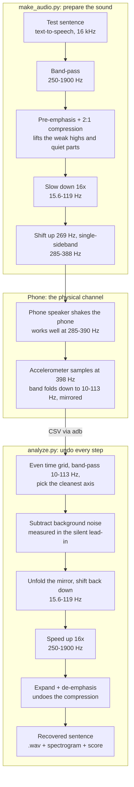
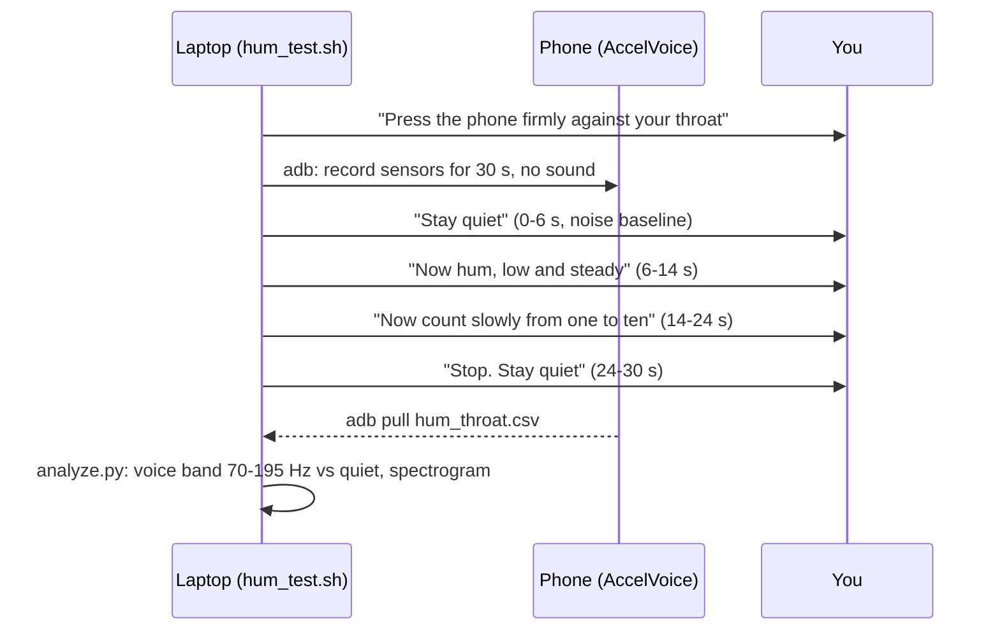
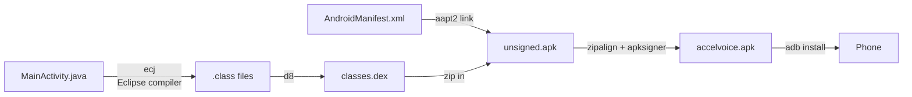

# accel-voice: inspired by Deepinder Goyal's Temple

Picking up speech with a phone's **accelerometer** instead of its microphone.

Everything runs on an ordinary Android phone plus a laptop: a tiny recorder app (no Gradle,
no Android Studio) and Python scripts that rebuild audio from the sensor readings.

## Listen

**[Watch the 30-second demo, with sound](docs/demo.mp4)**: the original sentence, then what came
back from the phone's accelerometer, each shown over its spectrogram.

| Clip | What you hear |
|---|---|
| [1_original.wav](docs/audio/1_original.wav) | The test sentence (250-1900 Hz) that the phone has to carry |
| [2_slowed10x_failed.wav](docs/audio/2_slowed10x_failed.wav) | Slowed 10x and recovered: only noise comes back |
| [3_shifted_recovered.wav](docs/audio/3_shifted_recovered.wav) | Slowed 16x and shifted to 285-390 Hz: the words come back, with hiss |
| [4_shifted_companded_recovered.wav](docs/audio/4_shifted_companded_recovered.wav) | Plus pre-emphasis and companding: quiet pauses, some hiss left in the words |

The sentence is synthetic text-to-speech, played through the phone's own speaker. The phone
recorded it with its accelerometer only; the app has no microphone permission.

**Real voice through bone ([39-second video](docs/placements.mp4)):** the phone pressed to the
throat and then the cheekbone while humming, then counting from one to ten. The sensor only
reaches ~199 Hz, so you hear the voice's pitch and rhythm, not words. Use headphones: most phone
and laptop speakers can't play sound this low.

| Clip | What you hear |
|---|---|
| [5_voice_throat.wav](docs/audio/5_voice_throat.wav) | Throat: voice +27 dB (hum) / +23 dB (count) above quiet |
| [6_voice_cheekbone.wav](docs/audio/6_voice_cheekbone.wav) | Cheekbone: voice +22 dB (hum) / +14 dB (count) above quiet |

## Results

Tested on an Oppo CPH2263 (Android 13, ST LSM6DS3C accelerometer). Android exposes it at about
**398 samples/s**, so the sensor can only see vibrations up to about **199 Hz**.

| Experiment | Result |
|---|---|
| Frequency sweep through the phone's own speaker | The speaker only shakes the phone above ~120 Hz. Above 199 Hz the signal folds back down (aliasing). |
| Speech slowed 10x, played through the phone's speaker | Nothing recovered: the slowed speech sits below 120 Hz, where the speaker can't move the phone. |
| Speech slowed 16x **and shifted up to 285-390 Hz** | **Sentence recovered.** The sensor sees it folded to ~10-113 Hz; the analysis undoes the fold. Pre-emphasis plus 2:1 companding (`cshift`) quiets the pauses. |
| Real voice, phone pressed to the head or neck | The voice's pitch (~130 Hz) and each spoken word's timing show clearly, but there are no intelligible words: those need sound above 199 Hz. |


*20-400 Hz sweep: nothing below ~120 Hz; above 199 Hz the sweep folds back down.*


*Top: the original sentence. Middle: rebuilt from the accelerometer (slowed 16x, shifted, companded).*


*Humming, then counting 1-10, with the phone pressed to the throat and the cheekbone. Voice level
above quiet (hum / count): throat +27 / +23 dB, cheekbone +22 / +14 dB.*

Why the plain 10x slowdown fails: [docs/plain_slowdown.png](docs/plain_slowdown.png).

### Limits

- **Real speech can't be heard from a phone accelerometer.** Words need roughly 1.5-8 kHz of
  bandwidth. Phones cap apps at about 400-500 samples/s, even though the chip itself can run
  in the kHz range. Recovering the sentence only works because the test audio is slowed and shifted
  into the band the phone can see.
- **Single runs.** Each placement was measured once, so differences of a few dB are within
  run-to-run variation.

#### Phone accelerometers vs. what speech needs

A sensor can only capture vibrations up to half its sampling rate, so no current phone gets
close to what words need.

| Device | Fastest accelerometer rate apps can use | Highest sound frequency it can capture |
|---|---|---|
| Oppo CPH2263 (this project) | about 400 Hz (398 Hz measured) | about 199 Hz |
| Android flagships (Samsung Galaxy S, Google Pixel), typically | about 400–500 Hz | about 200–250 Hz |
| iPhone | about 100 Hz | about 50 Hz |
| **Needed for words** | 3,000+ Hz (Temple: 16,000 Hz, per its maker) | 1,500–8,000 Hz |

Only the Oppo row was measured in this project. The other phone rows are typical values.

## How it works

1. **`app/`**: an Android app that records the accelerometer and gyroscope as fast as the
   hardware allows. It requests `HIGH_SAMPLING_RATE_SENSORS` to lift Android 12+'s 200 Hz cap,
   and can play a sound file through the phone's speaker while recording. It has no microphone
   permission. Results are saved as CSV (`sensor, t_ns, x, y, z`).
2. **`make_audio.py`** makes the test sounds: a sweep, slowed speech, and slowed-and-shifted
   speech (single-sideband shift, optional pre-emphasis and companding).
3. **`analyze.py`** puts the sensor timestamps on an even time grid and picks the best axis.
   It then removes the steady background noise, undoes the alias fold and frequency shift,
   speeds the result back up and writes WAV files, spectrograms and scores.
4. **`run.sh`** and **`hum_test.sh`** drive the phone over adb and run the analysis.
   `hum_test.sh` speaks its instructions through the laptop, so you can keep the phone pressed
   to your head.

### System overview



### Signal path: how the sentence gets through a 398 Hz sensor (`cshift`)

The phone's speaker only moves the phone above ~120 Hz, and the sensor only sees up to ~199 Hz.
So the speech is slowed down and shifted into the band the speaker reproduces well. The
sensor's aliasing folds that band into its visible range, and `analyze.py` reverses every step.



### Real-voice test (`hum_test.sh`)

No sound is played. The laptop speaks the steps, which don't register on the sensor, while the
phone records your voice through bone.



### Building the app without Gradle (`build.sh`)



## Setup

Requirements: Linux, Java 17+ runtime, Python 3 with `numpy scipy pandas matplotlib`,
`ffmpeg` (its built-in flite text-to-speech makes the test sentence), `adb`, `bc`, `paplay`.

Install the Android build tools

```bash
# Android command-line tools from https://developer.android.com/studio#command-tools,
# unzipped to ~/Android/Sdk/cmdline-tools/latest
~/Android/Sdk/cmdline-tools/latest/bin/android --sdk=$HOME/Android/Sdk sdk install build-tools/35.0.1 platforms/android-34
```

Turn on USB debugging on the phone, connect it, then build and install the app:

```bash
./build.sh install
```

## Usage

Put the phone flat on a table, unlocked, with nothing touching it:

```bash
./run.sh sweep          # 20-400 Hz sweep: how well the speaker shakes the phone at each frequency
./run.sh speech 10      # speech slowed 10x (fails, see Results)
./run.sh shift 16       # speech slowed 16x and shifted into 285-390 Hz
./run.sh cshift 16      # same, plus pre-emphasis and companding
./run.sh raw 10         # record 10 s with no sound playing
```

Real voice through bone (follow the laptop's spoken instructions):

```bash
./hum_test.sh throat    # any placement name: throat, cheekbone, ...
```

To rebuild the clips and both videos in `docs/` from your own results (after running
`speech 10`, `shift 16`, `cshift 16`, and `./hum_test.sh` for each place listed in `PLACES`
in `make_demo.py`):

```bash
python3 make_demo.py
```

Outputs go to `data/`: the raw CSV, rebuilt WAVs and a spectrogram PNG. Test sounds are
generated into `audio/` on first use.

The speaker band (`PLAY_BAND_LO` in `make_audio.py`) was measured on one phone. Run
`./run.sh sweep` on yours and adjust it if needed.
